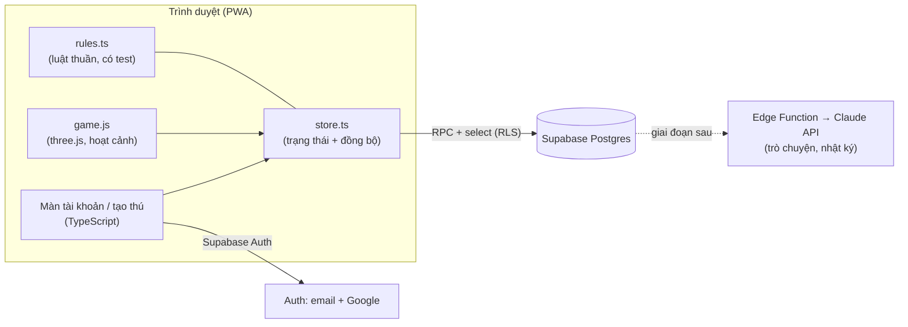

# TDD — Thú ảo đồng hành (giai đoạn 1: MVP chơi một mình)

Cập nhật: 31/10/2026. Tài liệu thiết kế game (GDD) nằm ở Claude Docs, tài liệu này mô tả cách xây dựng.

## 1. Kiến trúc



**Nguyên tắc:** server là nguồn sự thật cho chỉ số, thời gian và phần thưởng. Client đọc bảng qua RLS và chỉ ghi qua hàm RPC đã kiểm tra. Client áp dụng kết quả trước (optimistic) để cảm giác tức thì, rồi lấy kết quả server ghi đè.

## 2. Công nghệ

| Phần | Lựa chọn | Phiên bản |
| --- | --- | --- |
| Build | Vite | 8.3.4 |
| Ngôn ngữ | TypeScript (strict) | 6.0.3 |
| 3D | three.js | r186 (0.186.1) |
| Backend | Supabase (Postgres, Auth, RLS, RPC) | supabase-js 2.117.3 |
| Test | Vitest + PGlite (Postgres chạy trong Node) | 5.0.4 / 0.3.16 |

## 3. Cấu trúc thư mục

```
src/
  main.ts              Điều hướng: tài khoản → tạo thú → game
  lib/supabase.ts      Client Supabase (PKCE)
  lib/errors.ts        Đổi lỗi sang câu tiếng Việt
  auth/auth-ui.ts      Cổng, đăng nhập, đăng ký, quên & đặt lại mật khẩu
  onboarding/          Chọn trứng, đặt tên riêng + tên dòng họ
  data/api.ts, types.ts  Gọi RPC và bảng
  game/rules.ts        Luật thuần: giảm chỉ số, biểu cảm, nhật ký (+ test)
  game/store.ts        Trạng thái thú, hành động, gộp lô, đồng bộ định kỳ
  game/game.js         Hiển thị 3D + tương tác (chuyển từ bản mẫu)
  game/markup.html, game.css
supabase/migrations/   Schema, RLS, RPC
supabase/tests/        Test RPC trên PGlite
docs/TDD.md
```

## 4. Tài khoản

| Luồng | Cách làm |
| --- | --- |
| Đăng ký | `auth.signUp`. Nếu dự án tắt "Confirm email" thì vào chơi ngay (theo GDD). Bật thì hiện màn "Kiểm tra email". |
| Đăng nhập | `auth.signInWithPassword`. "Ghi nhớ tôi" tắt → phiên trình duyệt mới sẽ đăng xuất. |
| Google | `auth.signInWithOAuth({ provider: 'google' })` |
| Quên mật khẩu | `auth.resetPasswordForEmail(email, { redirectTo: '<site>?reset=1' })`. Luôn báo trung tính để không lộ email nào đã đăng ký. |
| Đặt lại | Link email mở `?reset=1` (hoặc sự kiện `PASSWORD_RECOVERY`) → `auth.updateUser({ password })` → `signOut({ scope: 'others' })`. |
| Hồ sơ | Trigger `on_auth_user_created` tạo dòng `profiles`. Client cập nhật `timezone` để tính "ngày" theo giờ địa phương. |

**Cấu hình cần bật trong Supabase Dashboard** (Authentication):
- Site URL + Redirect URLs: domain thật và `http://localhost:5173`.
- Độ dài mật khẩu tối thiểu: 8. Bật "Leaked password protection" (gói trả phí).
- Provider Google: tạo OAuth client trên Google Cloud, điền Client ID/Secret.
- Rate limit cho đăng nhập, gửi email. Bật CAPTCHA (Cloudflare Turnstile) trước khi ra mắt.
- Mẫu email (xác minh, đặt lại mật khẩu) viết lại bằng tiếng Việt, giọng ấm áp.
- Hết hạn link đặt lại: 3600 giây.

Khoá 15 phút sau 5 lần sai hiện chỉ có ở phía máy (trải nghiệm). Lớp bảo vệ thật là rate limit + CAPTCHA của Supabase. Nếu cần khoá theo tài khoản, thêm Auth Hook ở giai đoạn sau.

## 5. Dữ liệu

| Bảng | Nội dung | Client |
| --- | --- | --- |
| `profiles` | Múi giờ | đọc/sửa của mình |
| `pets` | Tên, dòng họ, gen, cá tính, 4 chỉ số, `stats_at`, ngủ | chỉ đọc |
| `pet_secrets` | Tuổi thọ (30–60 ngày), món tủ, món ghét | không truy cập |
| `items` | Món ăn, đồ trang trí, trang phục | đọc |
| `entitlements` | Quyền sở hữu vật phẩm (sẵn cho cosmetic) | đọc của mình |
| `memories` | Ký ức, `first_key` để "lần đầu" chỉ ghi một lần | đọc, xoá của mình |
| `day_logs` | Bộ đếm theo ngày → nhật ký | đọc |
| `diary_entries` | Trang nhật ký do AI viết (giai đoạn sau) | đọc |
| `action_log` | Nhật ký hành động để giới hạn tốc độ | không truy cập |

## 6. RPC

| Hàm | Tham số | Trả về | Lỗi |
| --- | --- | --- | --- |
| `get_my_pet()` | | thú hiện tại, đã áp giảm chỉ số tới giờ server | `not_authenticated` |
| `create_pet(name, family, egg)` | tên 1–16 ký tự, trứng 0–2 | thú mới; tạo bí mật, đồ khởi đầu, ký ức "gặp nhau" | `pet_exists`, `invalid_name`, `invalid_egg` |
| `rename_pet(name)` | | | `invalid_name` |
| `pet_action(action, item?, count?)` | `feed`, `pet`, `bath_scrub`, `bath_rinse`, `play_ball`, `play_spin`, `talk`, `sleep`, `wake` | `{ pet, refused, fav, new_memory }` | `unknown_action`, `unknown_item`, `not_owned`, `rate_limited`, `no_pet` |
| `add_talk_memory(text)` | 4–120 ký tự, tối đa 20/ngày | | `no_pet` |

`refused` là từ chối mềm (không phải lỗi): `full` (no ≥ 90), `tired` (năng lượng < 15), `asleep`.

## 7. Luật chỉ số và đồng bộ

- Giảm mỗi phút: No 0.9, Vui 0.5, Sạch 0.35, Năng lượng −0.45 (thức) / +3 (ngủ). Tối đa tính 3 ngày một lần. Hằng số nằm ở `rules.ts` và `private.decay_pet` — **phải sửa cả hai nơi** (test `rules.test.ts` + `rpc.test.ts` bảo vệ).
- Vuốt ve và kỳ cọ gộp theo lô 2 giây, tối đa 20 lần/lô. Giới hạn 30 hành động/10 giây/thú.
- Đồng bộ lại `get_my_pet` mỗi 60 giây và khi gửi hành động. Mất mạng thì game vẫn chạy bằng dự đoán.
- "Ngày" của nhật ký tính theo múi giờ trong `profiles`.

## 8. Bảo mật

- RLS bật trên mọi bảng (có test). Hàm RPC `security definer` với `search_path = ''`; hàm nội bộ ở schema `private`, đã thu quyền thực thi.
- `anon` không gọi được RPC nào (có test). Khoá dùng ở client là publishable key; secret key chỉ ở Edge Function.
- Dữ liệu người dùng nhập (tên, lời kể) luôn escape khi hiển thị.

## 9. Kiểm thử

| Lệnh | Nội dung |
| --- | --- |
| `npm test` | Luật chơi + toàn bộ RPC trên Postgres thật (PGlite) |
| `npm run typecheck` | TypeScript strict |
| `npm run build` | Build sản phẩm |

Đã chạy thử end-to-end trên Chromium với Supabase giả lập: cổng → lỗi biểu mẫu → đăng nhập → tạo thú → vào game → cho ăn.

## 10. Triển khai

1. Tạo dự án Supabase (region Singapore gần Việt Nam nhất).
2. `npx supabase link` rồi `npx supabase db push` để chạy migration.
3. Điền `.env` theo `.env.example`.
4. Host tĩnh thư mục `dist/` (Vercel, Netlify hoặc Cloudflare Pages), thêm domain vào Redirect URLs.

## 11. Việc tiếp theo

- Tách `game.js` thành module TypeScript (engine, areas, pet, face, fx, behaviors).
- **AI (đã hoãn theo yêu cầu):** Edge Function `chat` gọi Claude API với cá tính, chỉ số, 3–5 ký ức liên quan; Edge Function chạy theo lịch mỗi đêm viết `diary_entries`. Giới hạn lượt/ngày, câu mẫu dự phòng khi lỗi.
- Tiến hoá (gen → bộ phận), chế độ trang trí phòng, xu và cửa hàng.
- Service worker cho PWA (cache tài nguyên, thông báo đẩy).
- Đưa chữ giao diện ra file riêng để dễ dịch.
