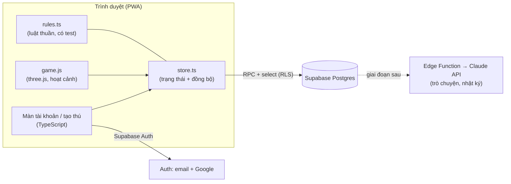

# TDD — Hatchday (giai đoạn 1: MVP chơi một mình)

Cập nhật: 31/10/2026. Tài liệu thiết kế game (GDD) nằm ở Claude Docs, tài liệu này mô tả cách xây dựng.

## 1. Kiến trúc



**Nguyên tắc:** server là nguồn sự thật cho chỉ số, thời gian và phần thưởng. Client đọc bảng qua RLS và chỉ ghi qua hàm RPC đã kiểm tra. Client áp dụng kết quả trước (optimistic) để cảm giác tức thì, rồi lấy kết quả server ghi đè.

## 2. Công nghệ

| Phần | Lựa chọn | Phiên bản |
| --- | --- | --- |
| Build | Vite | 8.3.4 |
| Ngôn ngữ | TypeScript (strict) | 6.0.3 |
| 3D | three.js | r186 (0.186.1) |
| Backend | Supabase (Postgres, Auth, RLS, RPC) | supabase-js 2.117.3 |
| Test | Vitest + PGlite (Postgres chạy trong Node) | 5.0.4 / 0.3.16 |

## 3. Cấu trúc thư mục

```
src/
  main.ts              Điều hướng: tài khoản → tạo thú → game
  lib/supabase.ts      Client Supabase (PKCE)
  lib/errors.ts        Đổi lỗi sang câu tiếng Việt
  auth/auth-ui.ts      Cổng, đăng nhập, đăng ký, quên & đặt lại mật khẩu
  onboarding/          Chọn trứng, đặt tên riêng + tên dòng họ
  data/api.ts, types.ts  Gọi RPC và bảng
  data/demo-api.ts     Chế độ chơi thử: mô phỏng RPC trên localStorage khi chưa có Supabase
  game/rules.ts        Luật thuần: giảm chỉ số, biểu cảm, nhật ký (+ test)
  game/catalog.ts      Danh mục vật phẩm (nguồn gốc của seed SQL), lưới, bố cục mặc định
  game/layout.ts       Luật thuần: đặt đồ, đường đi, điểm thoải mái, nhiệm vụ, tiệm xoay vòng (+ test)
  game/store.ts        Trạng thái thú, xu, đồ sở hữu, bố cục, trang phục, đồng bộ định kỳ
  game/game.js         Cảnh 3D, vòng lặp, camera, khu vực, hành vi rảnh (nối các mảng bên dưới)
  game/face.js         Mặt và biểu cảm (EXPR, drawFace)
  game/food.js         Thức ăn, khay theo kho, cho ăn (số liệu món: catalog.ts; ăn cân bằng: nutrition.ts)
  game/chat.js         Trò chuyện (bản mẫu, sau này nối AI)
  game/diary.js        Nhật ký ngày, Ký ức, bộ đếm hành động
  game/growth.js       Cảnh tiến hoá, thẻ loài
  game/audio.js        sfx()/music(): âm thanh tổng hợp bằng Web Audio
  game/dom.js          $, esc, clamp dùng chung
  game/home.js         Nhà: chế độ trang trí, cửa hàng, tủ đồ, nhiệm vụ, phản ứng của thú
  game/decor3d.js      Dựng mô hình toon cho đồ trang trí + trang phục (thủ tục, không cần file 3D)
  game/species.ts      50 loài, độ hiếm, luật lớn lên theo tuổi và dáng trưởng thành (+ test SQL so khớp)
  game/pet3d.js        Dựng thú theo loài + giai đoạn + dáng + gen (dùng cho game và Sổ loài)
  game/markup.html, game.css
supabase/migrations/   Schema, RLS, RPC
supabase/tests/        Test RPC trên PGlite
scripts/gen-seed.ts    Sinh câu INSERT items từ catalog.ts
docs/TDD.md
```

## 4. Tài khoản

| Luồng | Cách làm |
| --- | --- |
| Đăng ký | `auth.signUp`. Nếu dự án tắt "Confirm email" thì vào chơi ngay (theo GDD). Bật thì hiện màn "Kiểm tra email". |
| Đăng nhập | `auth.signInWithPassword`. "Ghi nhớ tôi" tắt → phiên trình duyệt mới sẽ đăng xuất. |
| Google | `auth.signInWithOAuth({ provider: 'google' })` |
| Quên mật khẩu | `auth.resetPasswordForEmail(email, { redirectTo: '<site>?reset=1' })`. Luôn báo trung tính để không lộ email nào đã đăng ký. |
| Đặt lại | Link email mở `?reset=1` (hoặc sự kiện `PASSWORD_RECOVERY`) → `auth.updateUser({ password })` → `signOut({ scope: 'others' })`. |
| Hồ sơ | Trigger `on_auth_user_created` tạo dòng `profiles`. Client cập nhật `timezone` để tính "ngày" theo giờ địa phương. |

**Cấu hình cần bật trong Supabase Dashboard** (Authentication):
- Site URL + Redirect URLs: domain thật và `http://localhost:5173`.
- Độ dài mật khẩu tối thiểu: 8. Bật "Leaked password protection" (gói trả phí).
- Provider Google: tạo OAuth client trên Google Cloud, điền Client ID/Secret.
- Rate limit cho đăng nhập, gửi email. Bật CAPTCHA (Cloudflare Turnstile) trước khi ra mắt.
- Mẫu email (xác minh, đặt lại mật khẩu) viết lại bằng tiếng Việt, giọng ấm áp.
- Hết hạn link đặt lại: 3600 giây.

Khoá 15 phút sau 5 lần sai hiện chỉ có ở phía máy (trải nghiệm). Lớp bảo vệ thật là rate limit + CAPTCHA của Supabase. Nếu cần khoá theo tài khoản, thêm Auth Hook ở giai đoạn sau.

## 5. Dữ liệu

| Bảng | Nội dung | Client |
| --- | --- | --- |
| `profiles` | Múi giờ | đọc/sửa của mình |
| `pets` | Tên, dòng họ, gen, cá tính, 4 chỉ số, `stats_at`, ngủ | chỉ đọc |
| `pet_secrets` | Tuổi thọ (30–60 ngày), món tủ, món ghét | không truy cập |
| `items` | Món ăn, đồ trang trí, trang phục: lớp, ô trang phục, kích thước ô, thoải mái, chủ đề, nhãn, giá, nguồn, độ hiếm | đọc |
| `entitlements` | Quyền sở hữu vật phẩm và số lượng | đọc của mình |
| `wallets` | Xu, xu chăm sóc đã nhận hôm nay | đọc của mình |
| `species` | 50 loài: tên, miền, độ hiếm, trọng số | đọc |
| `species_seen` | Sổ loài: loài đã từng nuôi, các dáng đã đạt | đọc của mình |
| `room_layouts` | 3 ô bố cục phòng (jsonb), `profiles.active_layout` chọn ô đang dùng | đọc của mình |
| `quest_claims`, `weekly_claims`, `ration_claims`, `collection_claims` | Đã nhận thưởng nhiệm vụ ngày (idx 5 = thưởng cả ngày) / nhiệm vụ tuần / suất ăn / bộ sưu tập | đọc của mình |
| `memories` | Ký ức, `first_key` để "lần đầu" chỉ ghi một lần | đọc, xoá của mình |
| `day_logs` | Bộ đếm theo ngày → nhật ký | đọc |
| `diary_entries` | Trang nhật ký do AI viết (giai đoạn sau) | đọc |
| `action_log` | Nhật ký hành động để giới hạn tốc độ | không truy cập |

## 6. RPC

| Hàm | Tham số | Trả về | Lỗi |
| --- | --- | --- | --- |
| `get_my_pet()` | | thú hiện tại, đã áp giảm chỉ số tới giờ server | `not_authenticated` |
| `create_pet(name, family, egg)` | tên 1–16 ký tự, trứng 0–2 | thú mới; tạo bí mật, đồ khởi đầu, ký ức "gặp nhau" | `pet_exists`, `invalid_name`, `invalid_egg` |
| `rename_pet(name)` | | | `invalid_name` |
| `pet_action(action, item?, count?)` | `feed`, `pet`, `bath_scrub`, `bath_rinse`, `play_ball`, `play_spin`, `talk`, `sleep`, `wake` (`feed` trừ 1 phần trong kho) | `{ pet, refused, fav, new_memory, earned, coins, stock, balanced }` | `unknown_action`, `unknown_item`, `not_owned`, `rate_limited`, `no_pet` |
| `add_talk_memory(text)` | 4–120 ký tự, tối đa 20/ngày | | `no_pet` |
| `get_my_pet()` (cập nhật) | | áp giảm chỉ số rồi `grow_pet`: đổi giai đoạn theo tuổi, chốt dáng khi trưởng thành, ghi ký ức; hết tuổi thọ thì chia tay (trả bé `departed` một lần rồi null) | |
| `create_pet(name, family, egg)` (cập nhật) | trứng = miền 0–4 | bốc loài theo độ hiếm trên server, ghi Sổ loài | `invalid_egg` |
| `get_economy()` | | xu, xu hôm nay, 6 món tiệm hôm nay, cuối tuần?, đã nhận suất ăn chưa | |
| `hatch_heir(name, egg)` | đón thú đời sau của bé đã đi, giữ dòng họ, đời + 1 | thú mới (thừa hưởng cá tính, tai, nửa sắc độ, sở thích, 50% món tủ) | `pet_exists`, `no_parent`, `invalid_name`, `invalid_egg` |
| `buy_food(item, qty)` | qty 1–10, kho tối đa 30 phần mỗi món | `{ coins, qty }` | `unknown_item`, `invalid_qty`, `stock_full`, `not_enough_coins` |
| `claim_ration()` | 3 Cơm nắm miễn phí, mỗi ngày một lần | `{ item, qty }` | `already_claimed` |
| `buy_item(item)` | | `{ coins, owned }` | `not_for_sale`, `already_owned`, `not_enough_coins` |
| `save_room_layout(slot, layout, activate)` | ô 0–2 | `{ comfort_level }` | `invalid_layout`, `not_owned` |
| `equip_outfit(outfit)` / `save_outfit_preset(slot, outfit)` | `{ head, face, neck, back }` | | `invalid_outfit`, `not_owned` |
| `get_quests()` | | `{ day, quests[5], bonus, week, weekly[3] }`, mỗi nhiệm vụ có tiến độ, mục tiêu, thưởng | |
| `claim_quest(idx)` / `claim_quest_bonus()` / `claim_weekly_quest(idx)` | nhiệm vụ ngày 0–4, thưởng làm đủ cả ngày, nhiệm vụ tuần 0–2 | `{ coins, reward }` | `invalid_quest`, `quest_not_done`, `already_claimed` |
| `claim_collection(theme)` | | +150 xu, ký ức | `invalid_theme`, `collection_incomplete`, `already_claimed` |

`pet_action` với hành động chăm sóc trả thêm `earned` và `coins` (+5 xu, tối đa 50 xu/ngày).

`refused` là từ chối mềm (không phải lỗi): `full` (no ≥ 90), `tired` (năng lượng < 15), `asleep`.

## 7. Luật chỉ số và đồng bộ

- Giảm mỗi phút: No 0.9, Vui 0.5, Sạch 0.35, Năng lượng −0.45 (thức) / +3 (ngủ). Tối đa tính 3 ngày một lần. Hằng số nằm ở `rules.ts` và `private.decay_pet` — **phải sửa cả hai nơi** (test `rules.test.ts` + `rpc.test.ts` bảo vệ).
- Vuốt ve và kỳ cọ gộp theo lô 2 giây, tối đa 20 lần/lô. Giới hạn 30 hành động/10 giây/thú.
- Đồng bộ lại `get_my_pet` mỗi 60 giây và khi gửi hành động. Mất mạng thì game vẫn chạy bằng dự đoán.
- "Ngày" của nhật ký tính theo múi giờ trong `profiles`.

## 7b. Nhà, trang trí và kinh tế

- **Lưới:** sàn 8×6 ô (GDD ghi 6×6, nới rộng để vừa phòng 3D), tường sau 8×3 ô (bỏ ô cửa sổ). 4 ô giữa (`PET_ZONE`) để dành cho thú. Khi đặt đồ kiểm tra: trong lưới, không chồng, không đè chỗ thú, không che cửa sổ, và BFS còn đường từ chỗ thú ra hàng trước (`layout.ts`). Server chỉ kiểm tra giới hạn + số lượng sở hữu (`private.check_layout`); chồng và đường đi kiểm ở client.
- **Lớp:** sàn, thảm (nằm dưới đồ), tường, giấy dán tường, sàn nhà.
- **Thoải mái:** cộng điểm thoải mái từng món (mỗi món tính tối đa 2 cái). ≥6 → cấp 2, ≥12 → 3, ≥20 → 4, ≥30 → 5. Mỗi cấp trên 1 giảm 5% tốc độ tụt Vui và Năng lượng, tăng 5% hồi khi ngủ. Áp ở cả `rules.decayStats` và `private.decay_pet`.
- **Bộ chủ đề:** ≥5 món khác nhau cùng chủ đề → thú thỉnh thoảng nói câu riêng của bộ. Sưu tập đủ một bộ → nhận 150 xu + ký ức.
- **Sở thích:** gen có 2 nhãn thích + 1 nhãn ghét. Đặt/mặc món hợp nhãn → thả tim; ghét → dỗi. Thú tự đi tới đồ yêu thích khi rảnh.
- **Kinh tế (chỉ xu, không gacha):** bắt đầu 300 xu. Chăm sóc +5 xu (tối đa 50/ngày), 5 nhiệm vụ/ngày (20–45 xu mỗi cái, làm đủ thêm 50 xu), 3 nhiệm vụ/tuần (100–110 xu). Thức ăn mua bằng xu (12–32 xu một phần), có suất ăn miễn phí mỗi ngày. Chợ bán cố định; Tiệm hôm nay xoay 6 món theo ngày; Chợ cuối tuần mở T7–CN; Quầy trả phí hiển thị "sắp mở".
- **Trang phục:** 4 ô (đầu, mặt, cổ, lưng), 3 bộ phối lưu sẵn.
- Hằng số và công thức xoay vòng/nhiệm vụ nằm ở `layout.ts` và các migration `20261105000000_decor_cosmetics.sql`, `20261114000000_food_economy.sql` — test `decor.test.ts`, `food.test.ts` so khớp hai bên.

## 7c. Loài và lớn lên

- **50 loài** = 5 miền (Đồng Nội, Sông Nước, Mây Trời, Rừng Đêm, Góc Bếp) × (4 Thường, 3 Hiếm, 2 Quý, 1 Huyền thoại). Trọng số 8/4/2/1 → mỗi miền: Thường ≈65%, Hiếm ≈24%, Quý ≈8%, Huyền thoại ≈2%.
- **Dáng cơ thể (5 kiểu):** bánh dẻo tròn (15 loài), bốn chân (13), đứng hai chân (11), chim (6), bay lượn thân khúc (8). Sơ sinh loài nào cũng tròn và đội vỏ trứng; từ Nhí mới hiện dáng riêng, đầu to → cân đối dần tới Trưởng thành. Đồ mặc bám theo đầu/thân của từng dáng (`offsets` trong `pet3d.js`).
- **Khác Pokémon:** thiết kế, tên, màu đều tự làm, cảm hứng Việt Nam (món ăn, cây cỏ, dân gian); mặt anime chung một phong cách. Không có hệ, không đánh nhau, không bắt thú, không mua trứng bằng tiền.
- **Ấp trứng:** người chơi chọn 1 trong 3 quả trứng (3 miền ngẫu nhiên). Server bốc loài (`private.pick_species`), client không chọn được. Gen `hue` (lệch sắc độ), `scale`, `ear` để không bé nào giống bé nào.
- **Giai đoạn theo ngày tuổi:** Sơ sinh (0–2, đội vỏ trứng) → Nhí (2–7, có chỏm, đuôi, hoa văn) → Thiếu niên (7–14, có phụ kiện) → Trưởng thành (14+, hào quang cho Huyền thoại) → Xế chiều (5 ngày cuối tuổi thọ, màu nhạt, tóc bạc). Tuổi thọ vẫn chỉ server biết.
- **Dáng trưởng thành** chốt lúc vào Trưởng thành, theo tổng `day_logs`: ăn → Phúng Phính, chơi bóng → Lanh Lợi, vuốt + nói → Tình Cảm, tắm → Lấp Lánh. Thiếu niên được báo "đang nghiêng về dáng…" để người chơi chủ động.
- **Hình dáng tiến hoá:** Sơ sinh (tròn, vỏ trứng) → Nhí (hiện dáng loài, đầu to) → Thiếu niên (cân đối, có phụ kiện) → Trưởng thành (nét riêng theo dáng: bờm cho thú bốn chân, lông đuôi dài cho chim, vây lưng + ria cho loài bay lượn; hào quang cho Huyền thoại). 4 dáng trưởng thành có dấu hiệu riêng: Phúng Phính (thân to, chân ngắn, bụng trắng, má phính), Lanh Lợi (chân/tai/đuôi dài, vệt gió hai bên), Tình Cảm (tim trên ngực và đuôi, tai hồng), Lấp Lánh (sao trên thân, sao bay quanh). Sổ loài hiện cả chuỗi tiến hoá.
- **Mặc đồ không lẹm (`fit.js`):** sau khi dựng, `pet3d` bắn tia đo "ổ cắm" trên chính mô hình: đỉnh đầu, mặt phẳng mắt, tiết diện cổ (x/z, độ nghiêng), mặt lưng (thú bốn chân đeo trên sống lưng) và vùng cấm (tai, sừng, chỏm, hào quang). Mũ len/vòng hoa ôm theo tiết diện đầu, tai chui qua lỗ có viền; mũ khác thử lần lượt: giữa đỉnh → nghiêng trái/phải → nghiêng trước → đeo sau gáy → thu nhỏ; nếu chỉ vướng chỏm đầu (hoa, sao, kem) thì mũ che chỏm. Khăn/chuông co giãn theo cổ; ba lô áp sát mặt lưng (cả mai rùa); áo choàng dựng lại theo cổ + thân (thú bốn chân/thân dài: tấm choàng phủ lưng).
- **Kiểm tra tự động:** `npm run build && node scripts/fit-check.mjs` thử 50 loài × 6 dáng/giai đoạn × 13 món (3.900 tổ hợp); báo lỗi nếu đồ đè tai/sừng/chỏm hoặc lún vào đầu/thân. Hiện 0 trường hợp. Thêm món mới thì chạy lại.
- **Cảnh tiến hoá:** thú phát sáng trắng, xoay, loé sáng rồi đổi hình (`evoGlow` trong shader toon). Tôn trọng `prefers-reduced-motion`.
- **Chế độ Chơi thử** có nút "Tua 1 ngày" để xem tiến hoá; bản thật không có (tuổi do server tính).
- Việc tiếp theo: thú mất khi hết tuổi thọ → trang tưởng niệm → trứng đời sau mang tên dòng họ, thừa hưởng một phần gen (gia phả).

## 8. Bảo mật

- RLS bật trên mọi bảng (có test). Hàm RPC `security definer` với `search_path = ''`; hàm nội bộ ở schema `private`, đã thu quyền thực thi.
- `anon` không gọi được RPC nào (có test). Khoá dùng ở client là publishable key; secret key chỉ ở Edge Function.
- Dữ liệu người dùng nhập (tên, lời kể) luôn escape khi hiển thị.

## 9. Kiểm thử

| Lệnh | Nội dung |
| --- | --- |
| `npm test` | Luật chơi + toàn bộ RPC trên Postgres thật (PGlite) |
| `npm run typecheck` | TypeScript strict |
| `npm run build` | Build sản phẩm |

Đã chạy thử end-to-end trên Chromium với Supabase giả lập: cổng → lỗi biểu mẫu → đăng nhập → tạo thú → vào game → cho ăn.

## 10. Triển khai

1. Tạo dự án Supabase (region Singapore gần Việt Nam nhất).
2. `npx supabase link` rồi `npx supabase db push` để chạy migration.
3. Điền `.env` theo `.env.example`.
4. Host tĩnh thư mục `dist/` (Vercel, Netlify hoặc Cloudflare Pages), thêm domain vào Redirect URLs.

## 11. Việc tiếp theo

- Tách `game.js` thành module TypeScript (engine, areas, pet, face, fx, behaviors).
- **AI (đã hoãn theo yêu cầu):** Edge Function `chat` gọi Claude API với cá tính, chỉ số, 3–5 ký ức liên quan; Edge Function chạy theo lịch mỗi đêm viết `diary_entries`. Giới hạn lượt/ngày, câu mẫu dự phòng khi lỗi.
- Tiến hoá (gen → bộ phận).
- Quầy trả phí (cosmetic bán bằng tiền thật) — cần cổng thanh toán và Edge Function xác minh giao dịch.
- Mô hình 3D thật (glTF) thay cho đồ dựng thủ tục khi có hoạ sĩ.
- Service worker cho PWA (cache tài nguyên, thông báo đẩy).
- Đưa chữ giao diện ra file riêng để dễ dịch.
